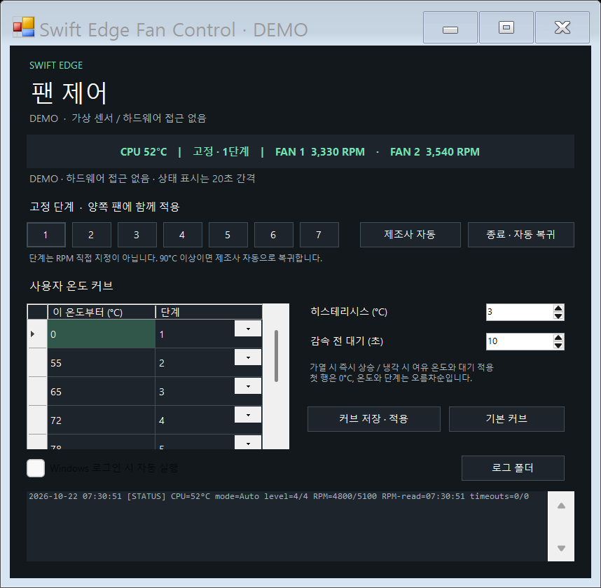
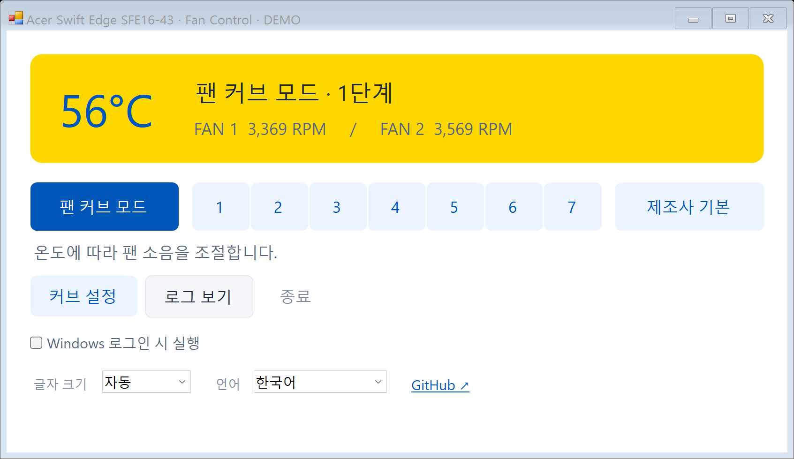
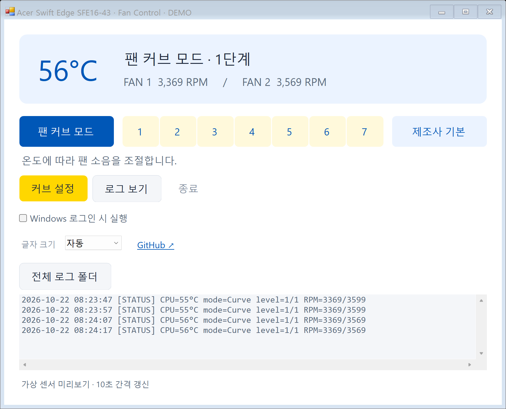

# Acer Swift Edge SFE16-43 · Fan Control

Acer Swift Edge **SFE16-43**에서 팬 소음을 줄이기 위한 실험용 Windows 트레이 앱입니다. 고정 팬 단계 또는 사용자 온도 커브를 적용하고, 실제 CPU 온도와 양쪽 팬 RPM을 확인합니다.

> **1~7은 EC의 팬 단계입니다. 정확한 RPM을 직접 지정하는 기능이 아닙니다.** 2,500 RPM 고정은 구현되지 않았습니다. 제조사 공식 앱이 아니며, 다른 Acer 노트북에 같은 EC 주소를 적용하면 안 됩니다.



`팬 커브 모드 → 고정 1~7단계 → 제조사 기본` 순서로 모드를 선택합니다. 바로 아래에 현재 모드의 설명을 표시하고, `커브 설정 / 로그 보기 / 종료` 버튼을 유지합니다. `제조사 기본`은 수동 제어를 해제해 제조사 자동 제어로 돌려주는 버튼입니다. 모델명을 포함한 제목은 창의 제목 표시줄에만 두며, 하단에 글자 크기 선택과 GitHub 링크를 제공합니다.

흰 배경에 우크라이나 국기의 파랑(`#0057B7`)·노랑(`#FFD700`)을 적용했습니다. 상태 카드는 진한 노랑, 모든 모드 버튼과 커브 설정은 옅은 하늘색이며 선택·누름 상태는 파랑입니다. 로그 버튼은 회색, 종료는 낮은 강조도로 유지합니다. 둥근 모서리는 투명색 대신 불투명한 상위 배경을 먼저 칠해 검은 테두리 영역이 생기지 않도록 처리합니다. 로그인 자동 실행 체크박스는 유지하며, 하단의 온도·RPM 안내 문장은 제거했습니다.

**기본 UI 언어는 English입니다.** 하단 Language 메뉴에서 English / 한국어 / 日本語 / 简体中文 / Español / Deutsch를 선택하면 메인 화면·커브 편집기·트레이 메뉴와 입력 안내가 함께 전환되고 선택값을 저장합니다. 센서 로그의 STATUS 형식과 진단 원문은 공통 형식을 유지합니다.





## 기능과 사용 목적

- **고정 1~7단계:** 양쪽 팬에 같은 단계를 적용합니다. CPU 온도 **90°C 이상**이면 제조사 자동 제어로 복귀하고, 사용자가 다시 선택할 때까지 수동 제어를 재개하지 않습니다.
- **사용자 팬 커브 — 기본 모드:** 별도 창의 그래프와 표에서 온도별 1~7단계, 히스테리시스(1~10°C), 감속 전 대기(0~120초)를 설정합니다. 가열 시 즉시 올리고 냉각 시 여유 온도와 지연을 적용합니다. 기본 커브는 60°C 미만 1단계, 60°C부터 2단계, 65°C부터 3단계입니다. 이후에는 마지막 선택 모드를 저장하며, 보호 동작으로 전환된 제조사 자동 모드는 임의로 재개하지 않습니다.
- **제조사 디폴트:** 수동 제어 비트를 해제해 펌웨어에 제어를 돌려줍니다. 앱의 사용자 커브와는 별도 모드입니다.
- **상태 표시:** 온도·팬 단계·양쪽 RPM을 약 10초마다 함께 읽고 새 측정값으로 화면과 STATUS 로그를 갱신합니다. 사용자 모드 변경은 대기 중에도 바로 처리합니다. 90°C 보호도 이 측정 간격에서 감지하므로 온도 상승 직후 최대 약 10초와 통신 지연이 있을 수 있습니다.
- **동적 글자 크기:** 창 너비와 모니터 작업 영역에 따라 글자·여백을 조절합니다. Per-Monitor DPI 변경을 처리하며 `자동 / 115% / 130% / 150%`를 선택할 수 있습니다.
- **글자 크기 변경 최적화:** 내부 패널의 재배치를 묶고 중간 그리기를 억제하며 폰트를 재사용합니다. 버튼 글자 맞춤도 같은 갱신에서 처리해 멈춤과 반복 그리기를 줄였습니다.
- **로그:** 화면에는 날짜·CPU 온도·모드·단계·RPM을 담은 STATUS 줄만 표시하며, 펼치면 약 4줄을 읽을 수 있습니다. 통신 재시도·설정 변경·자동 복귀 등 진단 기록은 파일에 보존합니다. 하루 파일당 4MiB에서 한 번 회전하고 14일 지난 로그를 정리합니다.
- **로그인 시 자동 실행:** 체크하면 앱과 EC 모듈을 보호된 `%ProgramFiles%\SwiftEdgeFanControl`에 복사하고 현재 사용자의 로그인 작업을 등록합니다. 배터리에서도 실행하며 마지막 저장 모드를 적용합니다. 이 기능은 로그인 전 부팅 서비스가 아닙니다.
- **트레이:** 창의 X는 트레이로 숨깁니다. `종료 · 자동 복귀` 또는 트레이의 종료 메뉴가 실제 종료입니다.
- **보호:** 지속적인 읽기 실패, 비정상 팬 센서, 외부 단계 변경, 워치독 종료 시 제조사 자동으로 복귀합니다. 절전·복귀 시 자동 모드로 전환하며 수동 재개는 사용자가 선택합니다.

팬 소음과 냉각 성능의 균형을 직접 정하는 용도입니다. 저소음이 모든 부하에서 가능한 것은 아니며, 배터리 절약 효과와 자원 사용량은 아직 정량 측정하지 않았습니다.

## 확인된 호환성 — 범용 Acer 지원이 아닙니다

| 항목 | 조사·실측한 장비 |
|---|---|
| 모델 | Acer Swift Edge SFE16-43, Windows 모델명 `Swift SFE16-43` |
| 보드 | `Ray_PEU` |
| BIOS | `V1.71` |
| OS | 해당 장비의 Windows x64 |
| 드라이버 | 기존 설치된 공식 PawnIO + 서명된 `LpcACPIEC.bin` |

현재 앱은 위 모델/보드/BIOS 조합만 허용합니다. SMBIOS EC 버전 원시 값은 major=1, minor=16(0x10)였으며 이를 문자열 `1.16`이라고 확정하지 않았습니다.

**제어 경로가 확인된 것과 앱의 장시간 안정성이 검증된 것은 다릅니다.** 선행 Python 프로토타입에서 1단계를 10분 유지했고 CPU 50~63°C, 팬 약 3,076~3,353 / 3,506~3,546 RPM을 기록했습니다. 다른 1시간 시험은 약 6분 40초에 두 단계가 외부에서 4로 바뀌어 중단됐습니다. 당시 원인은 확정되지 않았습니다. 읽기 타임아웃도 여전히 발생합니다. 단계 6·7과 각 단계의 정상 RPM, 앱의 장기 동작·절전·로그인 실행은 별도 검증이 필요합니다.

세부 결과와 실제 앱 시험 범위는 [검증 기록](docs/VALIDATION.md)에 구분합니다. 다른 기기에서는 앱의 제한을 단순히 제거하지 말고 [AI와 함께 호환 프로필을 조사하는 절차](docs/PORTING_WITH_AI.ko.md)를 따라 새 근거를 확보하세요.

## 실행

1. [공식 PawnIO](https://pawnio.eu/)를 설치합니다. 앱은 드라이버를 설치하거나 보안 설정을 해제하지 않습니다. 이미 설치돼 있다면 재설치할 필요가 없습니다.
2. 저장소의 `downloads/SwiftEdgeFanControl-win-x64.zip`을 내려받아 **폴더 전체를 압축 해제**합니다. `SwiftEdgeFanControl.exe`와 `LpcACPIEC.bin`을 함께 둡니다.
3. EXE를 실행합니다. 실제 제어에는 관리자 권한이 필요하며 UAC 승격을 요청합니다. 첫 실행 기본 모드는 팬 커브입니다.
4. `팬 커브 모드`, 고정 단계 `1~7`, `제조사 기본` 중 하나를 누릅니다. 커브 편집은 아래 `커브 설정` 버튼을 사용하고 `저장 · 커브 모드 적용`으로 반영합니다. 표시된 RPM과 실제 적용 상태를 확인합니다.
5. 필요하면 `Windows 로그인 시 자동 실행`을 체크합니다. 해제하면 예약 작업을 제거합니다. 설치 위치의 파일과 개인 설정/로그는 남습니다.

배포 EXE는 아직 Authenticode 서명되지 않았습니다. 앱과 모듈을 임의로 교체하지 마세요. 본 릴리스의 SHA-256은 `downloads/SHA256SUMS.txt`에 제공합니다. 90°C 기준은 이 앱의 CPU 센서에만 적용되며 모든 부품의 온도를 보장하는 기준은 아닙니다. 두 프로세스가 함께 종료되거나 OS가 멈추면 워치독도 동작할 수 없습니다.

설정: `%LOCALAPPDATA%\SwiftEdgeFanControl\settings.json`  
로그: `%LOCALAPPDATA%\SwiftEdgeFanControl\logs\`

## 직접 빌드 / 하드웨어 없는 미리보기

Windows x64, .NET Framework 4.x 컴파일러를 사용합니다. Electron, Node, Python 또는 별도 .NET SDK는 앱 실행에 필요하지 않습니다.

```powershell
powershell.exe -NoProfile -ExecutionPolicy Bypass -File .\build.ps1
powershell.exe -NoProfile -ExecutionPolicy Bypass -File .\build.ps1 -Development
.\build\development\SwiftEdgeFanControl.exe --demo
```

`build.ps1`은 소스를 컴파일하고 실제 하드웨어에 접근하지 않는 정책·오류 복귀 검사를 실행합니다. 기본 배포 빌드는 `build/release`에 생성됩니다. `-Development` 빌드만 가상 센서 `--demo`와 화면 검증 `--render-demo`를 포함하며, 관련 코드는 `tests/Preview.cs`에 분리했습니다. 실제 팬을 강제로 조작하는 `--smoke30`, `--smoke-crash`, 시작 작업을 변경하는 `--test-startup` 명령은 삭제했습니다.

`package.ps1`은 배포 빌드와 검사를 실행한 뒤 경량 ZIP을 만듭니다. ZIP에는 실행 파일, EC 모듈 한 벌, 짧은 사용 안내와 라이선스·모듈 소스만 포함합니다. 미리보기 이미지, 개발 문서와 테스트 실행 파일은 포함하지 않습니다. 자세한 문서와 AI 이식 절차는 이 저장소에서 볼 수 있습니다.

## 어떻게 작동하나요?

```text
고정 단계 / 온도 커브 → 정책 엔진 → 모델·BIOS 검사 → PawnIO → ACPI EC
                                     ↑             ↓
                             온도·단계·RPM 읽기 ← 실제 하드웨어
독립 워치독 ← 새 온도 읽기 후 생존 신호 → 응답 중단 시 제조사 자동 복귀
```

제조사 WMI 팬 명령은 이 장비에서 성공처럼 보이는 반환값을 줘도 RPM이 바뀌지 않았습니다. 공식 구버전 BIOS 1.63 패키지의 EC 코드를 실행 없이 분석한 뒤, 현재 V1.71 장비에서 별도 짧은 실험으로 실제 작동을 확인했습니다. **구버전 분석만으로 현재 펌웨어가 같다고 가정하지 않았습니다.** BIOS를 플래시하지 않습니다.

현재 프로필은 표준 ACPI EC 포트 `0x66/0x62`를 통해 읽기 `0x80`, 쓰기 `0x81` 명령을 사용합니다. EC `0x00`의 bit 1을 설정하고 `0x55`, `0x4F`에 팬 단계를 씁니다. 자동 복귀는 다른 비트를 보존하면서 bit 1을 해제하고 읽기로 검증합니다. 온도는 `0x58`, 팬 RPM은 `0x5C/0x5D`, `0x6A/0x6B`를 읽습니다. 이 주소들은 **위 장비에서 확인한 프로필**이며 범용 규격이 아닙니다.

`Global\Access_EC` 뮤텍스, 제한된 읽기 재시도, 공유 잠금 밖의 무작위 대기, 처음 2ms의 짧은 빠른 폴링을 사용합니다. Windows ACPI 드라이버가 이 사용자 뮤텍스를 존중한다고 보장할 수는 없으며, 드라이버 내부의 원자적 EC 트랜잭션은 아닙니다. UI와 센서 제어는 다른 스레드이고, 독립 워치독은 8초 이상 새 생존 신호가 없으면 자동 모드를 복구합니다. 구현은 [src](src), 구조·제한은 [ARCHITECTURE](docs/ARCHITECTURE.md)에 있습니다.

## 출처와 라이선스

앱의 원본 소스는 MIT 라이선스입니다. `vendor`의 PawnIO EC 모듈과 소스는 **LGPL-2.1-or-later**이며 별도 라이선스를 유지합니다. 앱 패키지는 PawnIO 드라이버·DLL, Acer BIOS 이미지 또는 Windows 구성 요소를 재배포하지 않습니다.

- [PawnIO](https://github.com/namazso/PawnIO), [공식 EC 모듈 소스](https://github.com/namazso/PawnIO.Modules/blob/main/LpcACPIEC.p), [모듈 릴리스](https://github.com/namazso/PawnIO.Modules/releases)
- [참고했던 Acer 앱](https://github.com/jsserve-org/vibed-acer-fan-control): UI 기능 설명만으로 이 모델의 수동 제어 가능성을 확정하지 않고 실제 RPM을 확인했습니다.
- [제3자 구성요소 안내](vendor/NOTICE.md)

## English summary

Experimental, model-gated Windows fan controller for Acer Swift Edge **SFE16-43 / Ray_PEU / BIOS V1.71**. Supports fixed **EC levels** 1–7, custom temperature curves with hysteresis and cooling delay, automatic fallback when CPU ≥90°C is sampled, 10-second sensor/status/log updates, tray operation and optional elevated logon startup. Levels are not exact RPM targets. Install official PawnIO separately. The prototype completed a 10-minute level-1 test, but a longer run was interrupted by an unexplained external level change. Read timeouts remain; this is not a claim of broad compatibility or proven long-term stability. Unsupported systems are blocked. See the Korean [AI-assisted porting workflow](docs/PORTING_WITH_AI.ko.md) before building a new hardware profile.
